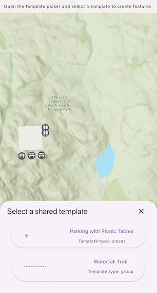

# Add features with shared template

Create features from preset and group shared templates.

## Use case

Preset and group shared templates support guided, repeatable, high-quality editing. Preset templates place predefined feature arrangements, while group templates create feature sets relative to a user-defined base geometry. By automatically applying attributes, symbology, geometry settings, and feature relationships/associations, they help field staff create consistent, fully configured assets with only a few choices.

## How to use the sample

Open the shared template picker and select a template. Tap on the map to place the geometry. Tap "Save" to create and add the features locally, or "Cancel" to discard the sketch.

## How it works

1. Create a web map using the URL to a web map.
2. Determine the `SharedTemplateSource` by inspecting map layers, identifying `FeatureLayer` instances backed by a `ServiceFeatureTable`, and retrieving their `ServiceGeodatabase`.
3. Call `SharedTemplateSource.querySharedTemplates()` to populate a template picker. Store each template's `layerId` and display its name and type.
4. Call `SharedTemplate.createSwatch(layerId)` to generate a swatch image for each template, falling back to a default image when a swatch is unavailable.
5. Call `SharedTemplate.getDefaultConstructionTool(layerId)` to get the template’s default construction method. Use its `GeometryConstructionTool.toolType` to choose whether the `GeometryEditor` draws a point or polyline.
6. After the user taps "Save", call `GeometryEditor.stop()` and use the returned geometry to create features with `SharedTemplateSource.createFeatures(sharedTemplate, geometry)`. Then call `SharedTemplateSource.addFeatures(featureCreationSet)` to add the resulting feature set to the geodatabase.

## Relevant API

* FeatureLayer
* GeometryConstructionToolType
* GeometryEditor
* ServiceFeatureTable
* ServiceGeodatabase
* SharedTemplate
* SharedTemplateFeatureCreationSet
* SharedTemplateSource

## About the data

This sample uses the [Parks and Grounds Assets](https://www.maps.arcgis.com/home/item.html?id=b635be46dfb545b888077389ac7f0962) web map.

## Tags

edit, feature, group, preset, shared template, shared template source, template
